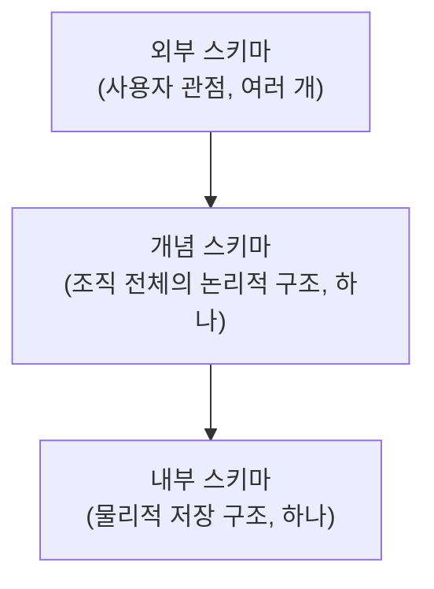

[[데이터베이스/데이터베이스.md|데이터베이스]]의 스키마는 바라보는 관점에 따라 외부 스키마, 개념 스키마, 내부 스키마의 3단계로 나뉜다. 이 구조를 도입하는 이유는 상위 스키마가 하위 스키마의 변경에 영향을 받지 않도록 하기 위해서이며, 이를 [[데이터베이스/데이터 독립성.md|데이터 독립성]]이라고 한다.

| 구분 | 관점 | 개수 |
|---|---|---|
| 외부 스키마 (External Schema) | 사용자나 응용 프로그램 | 여러 개 가능 |
| 개념 스키마 (Conceptual Schema) | 조직 전체 | 단 하나 |
| 내부 스키마 (Internal Schema) | 물리적 저장장치 | 단 하나 |

## 외부 스키마

사용자나 응용 프로그램의 관점에서 데이터베이스를 표현하는 개별적이고 주관적인 뷰이다.

- 전체 데이터베이스 중 사용자가 필요로 하는 일부분만을 정의한다.
- 한 데이터베이스에 여러 개의 외부 스키마가 존재할 수 있다.

## 개념 스키마

조직 전체의 입장에서 데이터베이스를 통합한 전체적인 논리적 구조이다.

- 모든 사용자용 데이터와 관계를 통합한 조직 전체의 뷰이다.
- 데이터베이스에 단 하나만 존재한다.
- 객체 간의 관계, 무결성 제약조건, 보안 및 권한 정책을 정의한다.
- 흔히 말하는 [[데이터베이스/데이터 모델링/데이터 모델링.md|데이터 모델링]]의 결과물에 해당한다.

## 내부 스키마

물리적 저장장치의 관점에서 데이터가 실제로 기록되는 저장 구조이다.

- 데이터베이스에 단 하나만 존재한다.
- 레코드의 물리적 순서, 내부 레코드 형식, 인덱스의 유무 및 데이터 압축/암호화 방법 등을 다룬다.
